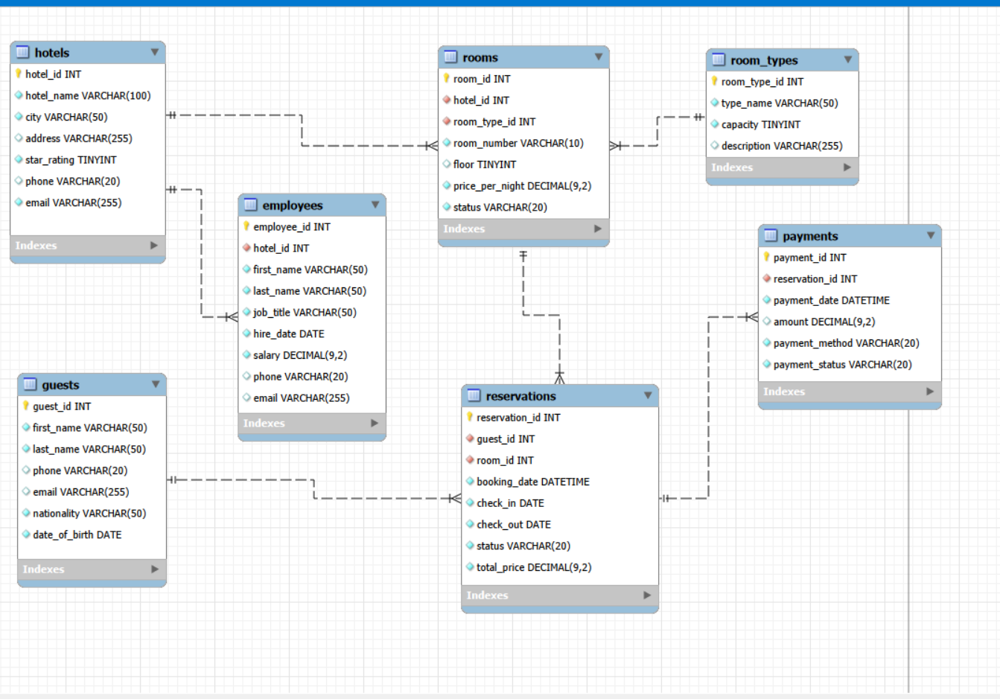

# Hotel Management & Reservation Database

A complete relational database project for managing hotel operations, reservations, guests, rooms, employees, payments, and business reporting.

This project was designed and implemented in **MySQL** with a focus on relational database design, data integrity, business logic, analytical SQL, stored routines, transactions, triggers, and query optimization.

Rather than being only a collection of tables and basic queries, the project models a small hotel reservation system and includes database-side logic for common real-world operations such as creating reservations, recording payments, preventing overlapping bookings, tracking reservation status changes, calculating balances, and analyzing hotel performance.

---

## Project Overview

The database represents a hotel management system containing multiple hotels, room types, rooms, guests, employees, reservations, and payments.

The main goals of the project are to:

- Design a normalized relational database from scratch
- Model realistic relationships between hotel entities
- Enforce data integrity using primary keys, foreign keys, unique constraints, and check constraints
- Populate the database with realistic sample data
- Write business-oriented analytical queries
- Create reusable views for reporting
- Implement stored procedures with validation and error handling
- Create SQL functions for reusable calculations
- Use triggers to enforce business rules and maintain an audit log
- Demonstrate transaction management using `COMMIT` and `ROLLBACK`
- Create indexes based on actual query patterns
- Use `EXPLAIN` to evaluate query execution and indexing decisions

---

## Database Design

The system contains **7 main tables**:

| Table | Description |
|---|---|
| `hotels` | Stores hotel information such as name, city, rating, contact information, and address |
| `room_types` | Defines room categories, capacity, and descriptions |
| `rooms` | Stores individual hotel rooms, room types, prices, floors, and availability status |
| `guests` | Stores guest personal and contact information |
| `employees` | Stores employees working at each hotel |
| `reservations` | Stores hotel reservations, dates, status, guest, room, and reservation value |
| `payments` | Stores payments associated with reservations |

The project also creates an additional audit table:

- `reservation_status_log` — records changes made to reservation statuses.

---

## ER Diagram

The database structure was first modeled using an EER diagram in MySQL Workbench.



The original MySQL Workbench model is also included in the repository:

```text
hotel_model.mwb
```

---

## Relationships

The main relationships in the database are:

- One hotel can have many rooms
- One hotel can have many employees
- One room type can be assigned to many rooms
- One guest can make many reservations
- One room can have many reservations over time
- One reservation can have multiple payment records

Foreign keys use appropriate referential actions such as:

```sql
ON UPDATE CASCADE
ON DELETE RESTRICT
```

This prevents important parent records from being deleted while related data still exists.

---

## Data Integrity

Several database constraints are used to keep the data valid.

Examples include:

- Hotel star ratings must be between 1 and 5
- Room capacity must be greater than 0
- Room price must be positive
- Employee salary cannot be negative
- Reservation check-out must be after check-in
- Reservation total price cannot be negative
- Payment amount must be greater than 0
- Hotel room numbers must be unique within each hotel
- Guest, employee, and hotel email addresses are protected using unique constraints
- Reservation and payment statuses are restricted to predefined values

Example reservation statuses:

```text
Pending
Confirmed
Cancelled
Completed
```

Example payment statuses:

```text
Pending
Paid
Failed
Refunded
```

---

## Sample Dataset

The included `data.sql` file populates the project with a realistic sample dataset.

The seed dataset contains approximately:

- **4 hotels**
- **4 room types**
- **20 guests**
- **28 rooms**
- **16 employees**
- **40 reservations**
- **54 payment records**

The data includes different business scenarios such as:

- Completed reservations
- Confirmed reservations
- Pending reservations
- Cancelled reservations
- Fully paid reservations
- Partially paid reservations
- Reservations without payments
- Failed payments
- Pending payments
- Refunded payments
- Multiple payments for a single reservation

These cases make it possible to test analytical queries and database logic against more realistic situations.

---

# SQL Analysis

The `queries.sql` file contains **15 business-oriented analytical queries**.

They range from basic aggregation to more advanced subqueries and correlated subqueries.

Some of the questions answered include:

### Hotel Performance

- Which hotel has the highest total reservation value?
- Which hotel has the highest average room price?
- Which hotel has the highest number of completed reservations?
- Which hotel has the highest average reservation value?

### Room Analysis

- Which room type is booked most frequently?
- Which room generated the highest total paid revenue?
- Which room types generate more revenue than the average room type revenue?

### Guest Analysis

- Which guests have made more than one reservation?
- Which guests have spent more than the average guest spending?
- Which guests have the highest number of completed reservations?
- Which guests have never made a reservation?
- Which guests spend more than the average guest from the same nationality?

### Reservation & Payment Analysis

- What percentage of reservations were cancelled?
- Which reservations are unpaid or partially paid?
- Which month generated the highest gross paid revenue?

The analytical queries demonstrate concepts including:

```text
INNER JOIN
LEFT JOIN
GROUP BY
HAVING
COUNT
SUM
AVG
CASE
COALESCE
Subqueries
Correlated Subqueries
Date Functions
Aggregation
Filtering
Sorting
```

---

# Views

The project includes reusable SQL views to simplify frequently needed reports.

## `reservation_details`

Combines information from:

- Reservations
- Guests
- Rooms
- Room types
- Hotels

It provides a convenient combined representation of reservation information without requiring the same joins to be written repeatedly.

Example:

```sql
SELECT *
FROM reservation_details
WHERE status = 'Completed';
```

---

## `hotel_revenue_summary`

Provides a revenue summary for each hotel based on successful payment records.

It combines:

```text
hotels
→ rooms
→ reservations
→ payments
```

This view allows hotel revenue to be queried without manually rebuilding the aggregation logic.

---

## `reservation_payment_status`

Calculates the payment situation of each reservation.

For every reservation, it provides:

- Reservation total price
- Net amount paid
- Remaining balance
- Calculated payment status

Possible calculated statuses include:

```text
Unpaid
Partially Paid
Fully Paid
```

Refunded amounts are deducted when calculating the net amount paid.

---

# Stored Procedures

The project contains stored procedures that implement database-side business logic.

## `update_reservation_status`

Updates the status of an existing reservation.

Before performing the update, the procedure validates:

- Whether the reservation exists
- Whether the requested status is valid

Invalid input is rejected using:

```sql
SIGNAL SQLSTATE '45000'
```

Example:

```sql
CALL update_reservation_status(12, 'Completed');
```

---

## `add_payment`

Adds a payment record to an existing reservation.

The procedure validates:

- Reservation existence
- Positive payment amount
- Valid payment status

The payment timestamp is automatically generated using:

```sql
NOW()
```

Example:

```sql
CALL add_payment(
    12,
    250.00,
    'Credit Card',
    'Paid'
);
```

---

## `create_reservation`

The most advanced stored procedure in the project.

It creates a new reservation while applying several business rules before allowing the insert.

The procedure verifies:

- The guest exists
- The room exists
- Check-out is after check-in
- The room is not under maintenance
- The requested date range does not overlap an existing active reservation

The reservation price is calculated automatically using:

```text
number of nights × room price per night
```

The procedure also automatically assigns:

```text
booking_date → current timestamp
status       → Pending
```

This keeps reservation creation consistent and prevents invalid bookings.

---

# Functions

Two reusable SQL functions are included.

## `calculate_stay_nights`

Calculates the number of nights between a reservation's check-in and check-out dates.

Example:

```sql
SELECT calculate_stay_nights(
    '2026-12-10',
    '2026-12-14'
);
```

Result:

```text
4
```

---

## `calculate_remaining_balance`

Calculates the outstanding balance for a reservation.

The function:

1. Gets the reservation total price
2. Adds successful payments
3. Subtracts refunded amounts
4. Treats missing payments as zero
5. Returns the remaining amount

Example:

```sql
SELECT calculate_remaining_balance(40);
```

---

# Triggers

Triggers are used to enforce important rules even when data is inserted or updated directly without using stored procedures.

## `log_reservation_after_update`

Runs after a reservation is updated.

If the reservation status changes, the trigger automatically stores:

- Reservation ID
- Previous status
- New status
- Change timestamp

in:

```text
reservation_status_log
```

This creates a basic audit trail for reservation status changes.

---

## `prevent_overlapping_reservation_before_insert`

Runs before inserting a new reservation.

It checks whether another non-cancelled reservation already exists for the same room during an overlapping date range.

The overlap rule is based on:

```text
new_check_in < existing_check_out
AND
new_check_out > existing_check_in
```

If an overlapping reservation exists, the insert is rejected using:

```sql
SIGNAL SQLSTATE '45000'
```

This adds an additional database-level layer of protection against double booking.

---

# Transactions

The `transactions.sql` file demonstrates transaction management using:

```sql
START TRANSACTION
COMMIT
ROLLBACK
LAST_INSERT_ID()
```

## Transaction 1 — Reservation with Initial Payment

A reservation is created and its generated reservation ID is retrieved using:

```sql
LAST_INSERT_ID()
```

A payment is then created for the same reservation.

If the operations are successful, the transaction is committed.

This demonstrates how related database operations can be treated as a single logical unit.

---

## Transaction 2 — Rollback Demonstration

A reservation and payment are temporarily inserted inside a transaction.

The records are queried before rollback to demonstrate that they exist inside the current transaction.

Then:

```sql
ROLLBACK;
```

is executed.

The records are queried again afterward to verify that the changes were not permanently stored.

This demonstrates the atomic behavior of SQL transactions.

---

# Indexing & Query Optimization

Indexes were created based on actual queries used by the project rather than adding unnecessary indexes to every column.

One important use case is checking whether a room already has a reservation within a requested date range.

A composite index is used to improve this lookup:

```sql
CREATE INDEX idx_room_id_status_check_in_check_out
ON reservations (
    room_id,
    status,
    check_in,
    check_out
);
```

`EXPLAIN` was used before and after creating the index.

Before optimization, MySQL primarily relied on the foreign-key index for:

```text
room_id
```

After creating the composite index, the optimizer selected the new index and performed a covering index range scan for the reservation overlap query.

Another index supports payment filtering and revenue analysis using payment status and date.

```sql
CREATE INDEX idx_payment_status_date
ON payments (
    payment_status,
    payment_date
);
```

`EXPLAIN` confirmed that MySQL used this index when filtering successful payments in the monthly revenue analysis.

This section demonstrates that indexes in the project were created based on real access patterns and verified using the MySQL query optimizer.

---

# Project Structure

```text
hotel-management-sql/
│
├── schema.sql
├── data.sql
├── queries.sql
├── views.sql
├── procedures.sql
├── functions.sql
├── triggers.sql
├── transactions.sql
├── indexes.sql
│
├── hotel_model.mwb
│
├── docs/
│   └── hotel_database_erd_final.png
│
└── README.md
```

### File Descriptions

| File | Purpose |
|---|---|
| `schema.sql` | Creates the database, tables, relationships, constraints, and keys |
| `data.sql` | Inserts the sample dataset |
| `queries.sql` | Contains analytical and business queries |
| `views.sql` | Creates reusable reporting views |
| `procedures.sql` | Implements stored procedures and business validation |
| `functions.sql` | Contains reusable SQL calculation functions |
| `triggers.sql` | Creates audit and reservation validation triggers |
| `transactions.sql` | Demonstrates COMMIT and ROLLBACK scenarios |
| `indexes.sql` | Adds indexes used for query optimization |
| `hotel_model.mwb` | Original MySQL Workbench database model |
| `docs/` | Contains the ER diagram and project documentation assets |

---

# Technologies Used

- **MySQL**
- **MySQL Workbench**
- **SQL**
- **EER Database Modeling**

Major SQL concepts demonstrated:

```text
Database Design
Normalization
Primary Keys
Foreign Keys
Unique Constraints
Check Constraints
One-to-Many Relationships
Joins
Aggregations
Subqueries
Correlated Subqueries
Views
Stored Procedures
Stored Functions
Triggers
Transactions
Error Handling
Indexes
EXPLAIN
Query Optimization
```

---

# How to Run the Project

## 1. Clone the repository

```bash
git clone <repository-url>
```

Move into the project directory:

```bash
cd hotel-management-sql
```

---

## 2. Create the database structure

Run:

```text
schema.sql
```

This creates the `hotel_management` database and its main tables.

---

## 3. Insert sample data

Run:

```text
data.sql
```

This populates the database with hotels, room types, rooms, guests, employees, reservations, and payment records.

---

## 4. Create database objects

The remaining SQL files can then be executed:

```text
views.sql
procedures.sql
functions.sql
triggers.sql
indexes.sql
```

---

## 5. Run analytical queries

Execute:

```text
queries.sql
```

to explore the business and analytical questions included in the project.

---

## 6. Test transactions

Finally, the examples in:

```text
transactions.sql
```

can be executed to demonstrate `COMMIT` and `ROLLBACK` behavior.

> Transaction examples modify data temporarily or permanently depending on whether `COMMIT` or `ROLLBACK` is used, so they are best executed after the initial database setup.

---

# Recommended Execution Order

For a fresh installation, the recommended order is:

```text
1. schema.sql
2. data.sql
3. views.sql
4. procedures.sql
5. functions.sql
6. triggers.sql
7. indexes.sql
8. queries.sql
9. transactions.sql
```

---

# Key Business Rules

Some of the business rules enforced by the database include:

- A reservation cannot reference a non-existing guest
- A reservation cannot reference a non-existing room
- Check-out must occur after check-in
- Rooms under maintenance cannot be reserved through the reservation procedure
- Active room reservations cannot overlap
- Payment amounts must be positive
- Payment statuses must use supported values
- Reservation status changes can be audited
- Cancelled reservations are excluded from several reservation-performance calculations
- Successful payments are used when calculating gross paid revenue

---

# What I Learned

This project was built as a practical application of MySQL and relational database concepts.

Through the project, I practiced moving from database theory to a complete implementation, including:

- Designing an EER model before implementation
- Translating relationships into foreign keys
- Applying normalization principles
- Writing analytical queries for business questions
- Handling multi-table joins
- Using aggregate functions and grouped analysis
- Writing nested and correlated subqueries
- Creating reusable views
- Implementing stored procedures and validation
- Raising custom SQL errors
- Writing stored functions
- Automating database behavior with triggers
- Using transactions for data consistency
- Applying indexes based on query patterns
- Using `EXPLAIN` to evaluate query execution

The project also helped demonstrate how database logic can be used to protect data integrity instead of relying entirely on application-side validation.

---

# Possible Future Improvements

Possible extensions for the project include:

- Adding customer reviews and hotel ratings
- Supporting discount codes and seasonal pricing
- Adding room service and additional hotel services
- Creating employee shift management
- Creating a reservation cancellation history
- Adding check-in and check-out operations
- Implementing role-based database permissions
- Expanding the dataset for performance testing
- Adding more advanced query optimization tests
- Using CTEs and window functions for advanced analytics
- Connecting the database to a Python application
- Building a web or desktop interface for the reservation system

A future version of the project could connect MySQL with **Python** to create an application layer for reservations, payments, guest management, and reporting.

---

# Author

**Arman**

Computer Science student interested in:

- Python
- SQL
- Data Analysis
- Machine Learning
- AI Engineering

---

## Notes

This project was created for learning and portfolio purposes.

The dataset is synthetic and does not represent real customers or hotels.